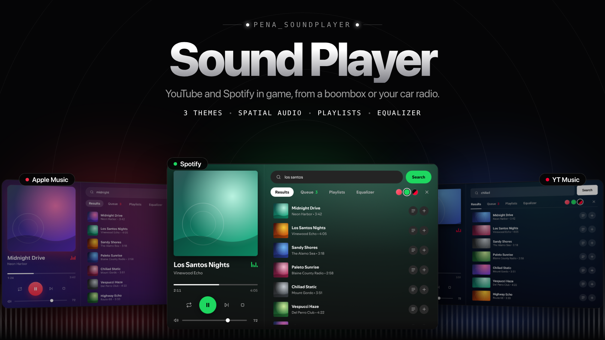

<p align="center">
  
</p>

<h1 align="center">pena_soundplayer</h1>

<p align="center">
  <b>Search and play music in game. Car radio, boombox, playlists, equalizer and real 3D sound.</b><br>
  Free, open source, no API key and no framework needed.
</p>

---

## What is it?

A music player for your FiveM server. Players search for a song, press play and everyone nearby hears it, from a car radio or from a boombox placed on the ground. The sound is positioned in the world: it gets quieter with distance, muffled behind walls, softer inside closed cars and louder with the windows down.

Everything runs on your own server. There is no external API key to buy, no subscription and no account to link.

## Features

**Playing music**
- Search by song or artist, results show up as you type
- Paste a YouTube link, or a Spotify track link (it finds the matching song and plays it)
- Queue, skip, pause, seek, loop and volume
- Car radio on a key (default `Q`), for the driver and front passenger
- Placeable boombox that anyone nearby can use and pick up
- Playlists with share codes, so players can send playlists to each other
- 5 band equalizer with saved presets and share codes

**3D sound**
- Volume falls off with distance and far away music gets muffled
- Left and right panning, and sound from behind you is duller
- Walls and objects between you and the music block it
- Different interior or room changes how it sounds
- Cars leak music depending on open doors, broken or open windows and convertible roofs
- Players inside a closed car hear the outside quieter

**UI**
- Three themes in one UI: Apple Music style, Spotify style and YT Music style
- Players can switch theme themselves, or you lock it in the config
- Custom accent color
- English and Finnish included, easy to add more
- Streamer mode command that mutes it for a player

**For server owners**
- Works with Qbox, QBCore, ESX or no framework at all, its a standalone
- Playlists and presets are saved in your database, the tables are created automatically
- Song blocklist by video id or by words in the title, plus admin commands to block songs live
- Limits for queue size, search and play cooldowns, playlists per player and more
- Audio is downloaded and cached on your server, with automatic cleanup by age and size
- Everything is configurable in `config.lua`, every option is commented

## Performance

Idles on **0.00ms**. It can go up to **0.04-0.05ms** with a lot of active sounds near the player. These numbers are only a guide and results may vary depending on the user's CPU.

Server side it is quiet when nobody is using it. The heavy work (searching and downloading) runs in the Node backend, outside the main game thread.

## Requirements

| What | Why |
| --- | --- |
| [OneSync](https://docs.fivem.net/docs/scripting-reference/onesync/) | Needed for the boombox and vehicle radio |
| [oxmysql](https://github.com/overextended/oxmysql) | Playlists, presets and the blocklist |
| A recent server build with Node 22 support | The audio backend runs in Node |
| Outbound internet from the server | Searching and downloading songs |
| Write access to the resource folder | The `cache` and `bin` folders are created automatically |

Python 3.9+ is optional. If the server has it, yt-dlp runs through Python, otherwise a standalone yt-dlp binary is used.

## Installation

1. Download the resource and put the `pena_soundplayer` folder in your `resources` folder.
2. Add it to your `server.cfg` after oxmysql. The `add_unsafe_child_process_permission` line is **required**, see the note below:

   ```cfg
   add_unsafe_child_process_permission "pena_soundplayer"

   ensure oxmysql
   ensure pena_soundplayer
   ```

3. Start the server. On the first start it downloads yt-dlp (checked against its published SHA-256 before it is used) and creates its database tables. No SQL file to import.
4. Join the server, get in a car and press `Q`.

> [!IMPORTANT]
> Without `add_unsafe_child_process_permission "pena_soundplayer"` in `server.cfg`, FXServer will not let the resource launch yt-dlp. Anticheats may also flag the resource for spawning a child process, so whitelist it there if needed.

## Usage

| Command | Who | What it does |
| --- | --- | --- |
| `Q` (rebindable) | Driver and front passenger | Open the car radio |
| `/boombox` | `group.admin` by default | Place a boombox. Stand next to it and press `E` to open it, `G` to pick it up |
| `/streamermode` | Everyone | Mute the sound player for yourself |
| `/songblock <link or id>` | `group.admin` by default | Block a song for everyone |
| `/songunblock <link or id>` | `group.admin` by default | Remove a song from the blocklist |
| `/songblocklist` | `group.admin` by default | List blocked songs |

Want the boombox as an item or in a shop? Call this from your own script:

```lua
exports.pena_soundplayer:placeBoombox(source)
```

## Configuration

Open `config.lua`. Some things you will probably want to change:

```lua
Config.theme = 'apple'            -- 'apple', 'spotify' or 'ytmusic'
Config.themeSwitcher = true       -- let players switch theme themselves
Config.accent = nil               -- for example '#00e5ff'
Config.carRadio.key = 'Q'
Config.carRadio.allowedSeats = 'front'
Config.boombox.commandGroup = ''  -- '' lets everyone use /boombox
Config.maxQueue = 15
```

Audio backend settings (cache size, how long songs are kept, how long a song can be, yt-dlp options) are in `backend.json`.

## Good to know

- The first time a song is played it has to be downloaded to the server, so it can take a few seconds to start. After that it starts right away until the cache cleans it up.
- Songs are limited to 15 minutes by default (`maxDurationSec` in `backend.json`).
- yt-dlp keeps itself up to date. Set `autoUpdateYtdlp` to `false` in `backend.json` if you do not want that.
- Hosts that block outbound connections will stop searching and downloading from working.

## Disclaimer

This resource gets its audio from YouTube using [yt-dlp](https://github.com/yt-dlp/yt-dlp). Downloading and playing content can go against YouTube's terms and against copyright law depending on the song and where you live. Running this on your server is your own responsibility, and you should decide what is allowed there. Use the blocklist to keep unwanted songs out.

This project is not affiliated with or endorsed by Apple, Spotify or YouTube. The themes are inspired by the look of those services, and their names belong to their owners.

## License

The code is released under the [MIT License](LICENSE). You can use it, change it and share it for free, including on your own server.

Third party files in `ui/fonts` belong to their owners and are not covered by that license.

## Support and contributing

Found a bug or have an idea? Open an issue or send a pull request on GitHub.

Made by **Pena**.